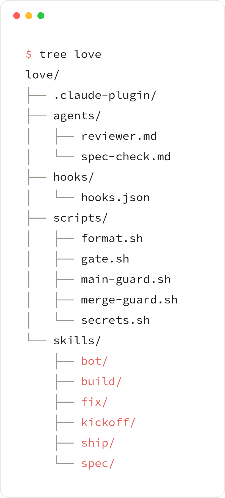

<div align="center">
  
  <p>You decide. Claude does the work.</p>
  <p><a href="README.pt-BR.md">Português</a> · <a href="CHANGELOG.md">Changelog</a> · <a href="CONTRIBUTING.md">Contributing</a></p>
  <p>
    <a href="https://github.com/thdtr/love/actions/workflows/ci.yml"></a>
    <a href="https://github.com/thdtr/love/releases/latest"></a>
    <a href="LICENSE"></a>
  </p>
</div>

love is a [Claude Code](https://code.claude.com/docs/en/overview) plugin for building software with agents. You describe what you want and approve a short spec. Claude builds it in small tested steps and opens the pull request. Checks run on every edit and every commit, so broken code never gets committed. Work that's ready can go to bots that build it in a container while you do something else.

<p align="center">
  <picture>
    <source media="(prefers-color-scheme: dark)" srcset="docs/tree-dark.png">
    
  </picture>
</p>

## Requirements

love runs on Linux. You need

- Claude Code
- git, bash 5 and jq
- [GitHub CLI](https://cli.github.com/), logged in with `gh auth login`, for pull requests, CI and the board
- [gitleaks](https://github.com/gitleaks/gitleaks) if you want secrets caught before each commit
- [Podman](https://podman.io/), only if you use bots

## Install

```sh
claude plugin marketplace add thdtr/love
claude plugin install love@love
```

Open Claude Code in your project and run `/kickoff`. It reads what's already there, asks only what the code can't tell it and shows every change before writing anything. It works on new projects and on projects that used another workflow.

Joining a project that already uses love? Run `/kickoff` too. It only sets up your machine.

## Commands

| Command | What it does |
|---|---|
| `/kickoff` | Sets up the project, or just your machine when the project is already set up |
| `/spec` | Alone, shows your inbox. With a description or `#42`, interviews you and writes the spec |
| `/build` | Builds the spec slice by slice, each with a test and a commit, then reviews it |
| `/fix` | Finds the root cause of a bug before touching the code. Also takes small changes |
| `/ship` | Opens the pull request and waits for CI. Merges only when you say so |
| `/bot` | Sends ready issues to bots |

## A feature from start to finish

```text
> /spec "customers can save products to a wishlist"
```

Claude reads the code, tells you what it understood and asks only what matters, with a suggested answer for each question. When the choice is about looks or feel, it can build two or three quick versions for you to compare. You approve, and the spec lands in `docs/specs/wishlist.md` on a new branch.

```text
> /clear
> /build wishlist
```

Each slice gets a test that fails first, then the code, a check in the running app when there's UI, and a commit. Claude makes small decisions on its own and writes them down, and asks you first about anything involving data, permissions or money. At the end an independent reviewer compares the result with the spec.

```text
> /ship
```

The pull request opens with what you need to look at on top, meaning the decisions Claude made alone, the 3 to 5 places worth your attention and the proof that it works. You merge when you're happy with it.

For a bug, run `/fix "the cart total ignores the coupon"`. For a typo, just ask.

## Your inbox

Run `/spec` with nothing after it and everything waiting for you shows up at once. That covers questions bots left, pull requests ready to merge and failing CI. You answer them in one go and get back to what you were doing.

GitHub issues are the board, and a label shows where each card is.

```text
needs-decision  →  ready  →  building  →  review
     you            you       Claude       you
```

## Bots

A bot picks a `ready` issue, builds it inside a Podman container that can only reach GitHub, Anthropic and your package registries, and opens the pull request. When it hits a decision it can't make alone, it asks on the issue and stops. Bots never merge.

Set it up once per machine.

1. Run `/kickoff` and say yes to bots.
2. Run `claude setup-token` and copy the token.
3. Create a [fine-grained GitHub token](https://github.com/settings/personal-access-tokens/new) for this repository only, with read and write on contents, issues and pull requests.
4. Save both tokens.

```sh
mkdir -p ~/.config/love
printf 'CLAUDE_CODE_OAUTH_TOKEN=%s\nGH_TOKEN=%s\n' 'claude-token' 'github-token' > ~/.config/love/bot.env
chmod 600 ~/.config/love/bot.env
```

Now `/bot` sends the oldest ready issue and `/bot 3` sends up to three. At most three issues are built at the same time. Each run writes its log to `.love/bot/logs/<issue>.log`.

## What runs on its own

| When | What happens |
|---|---|
| After each edit | The file gets formatted |
| Before each commit | Types, lint and the tests for what changed run, gitleaks looks for secrets, and code can't be committed straight to main |
| At the end of each turn | The same check runs on what wasn't committed |
| Before a merge | The merge is blocked while CI is running or red |

When a check fails, the commit doesn't happen and Claude fixes the cause. The checks live in your project, in `scripts/gate.sh`, and CI runs the same script with `--all`.

## What it adds to your project

| Path | What it's for |
|---|---|
| `AGENTS.md` | How to work in this project, in up to 60 lines |
| `CLAUDE.md` | Loads `AGENTS.md` |
| `docs/PROJECT.md` | Product, business rules and architecture, in up to 80 lines |
| `docs/specs/` | The spec of each feature in progress. It's folded into `PROJECT.md` and deleted on ship |
| `scripts/gate.sh` | The checks, quick and full |
| `scripts/format.sh` | The formatter for each file type |
| `.claude/settings.json` | Permissions and the plugin setup |
| `.claude/rules/` | Rules for tests and UI |
| `.github/workflows/ci.yml` | CI |
| `.love/bot/` | The bot container, if you use bots |

## Safety

Claude can't read your SSH keys, cloud credentials or gh token, and force push is blocked. Pushing, merging and opening issues ask you first. Keep only development credentials in your `.env`.

## Updating

Projects set up by `/kickoff` update love on their own, and the new version loads in your next session. To update by hand, open `/plugin`, go to Marketplaces, pick `love` and choose Update. Every change is in the [changelog](CHANGELOG.md).

## Contributing

See [CONTRIBUTING.md](CONTRIBUTING.md). To report a vulnerability, read [SECURITY.md](SECURITY.md).

## License

[MIT](LICENSE)
