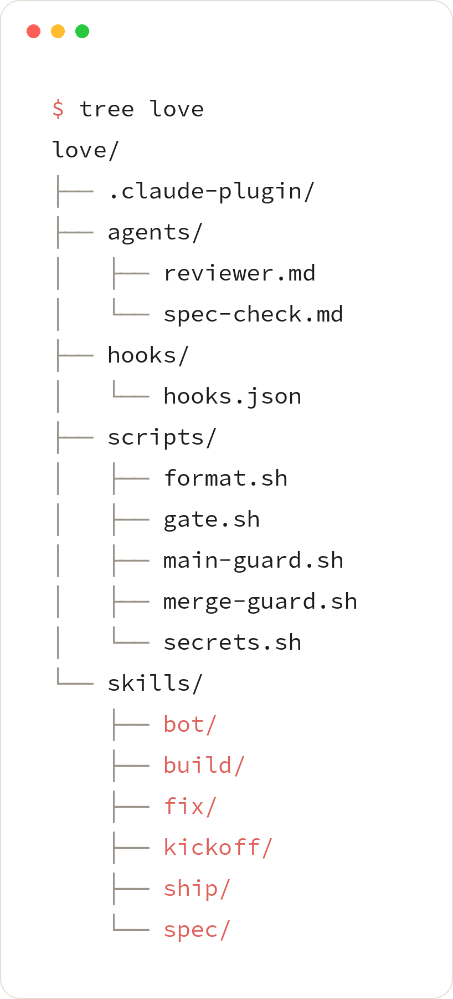

<div align="center">
  
  <p>Você decide. O Claude faz o trabalho.</p>
  <p><a href="README.md">English</a> · <a href="CHANGELOG.md">Changelog</a> · <a href="CONTRIBUTING.md">Como contribuir</a></p>
  <p>
    <a href="https://github.com/thdtr/love/actions/workflows/ci.yml"></a>
    <a href="https://github.com/thdtr/love/releases/latest"></a>
    <a href="LICENSE"></a>
  </p>
</div>

O love é um plugin do [Claude Code](https://code.claude.com/docs/pt/overview) para desenvolver software com agentes. Você conta o que quer e aprova uma spec curta. O Claude implementa em passos pequenos, com teste, e abre o pull request. As verificações rodam a cada edição e a cada commit, então código quebrado não entra no repositório. O que já está pronto pra ser feito pode ir para bots, que trabalham num container enquanto você cuida de outra coisa.

<p align="center">
  <picture>
    <source media="(prefers-color-scheme: dark)" srcset="docs/tree-dark.png">
    
  </picture>
</p>

## O que você precisa

O love roda no Linux. Você vai precisar de

- Claude Code
- git, bash 5 e jq
- [GitHub CLI](https://cli.github.com/), logado com `gh auth login`, para pull requests, CI e o quadro
- [gitleaks](https://github.com/gitleaks/gitleaks), se quiser barrar senhas e chaves antes de cada commit
- [Podman](https://podman.io/), só se for usar bots

## Instalação

```sh
claude plugin marketplace add thdtr/love
claude plugin install love@love
```

Abra o Claude Code no seu projeto e rode `/kickoff`. Ele lê o que já existe, pergunta só o que o código não responde e mostra cada mudança antes de escrever qualquer coisa. Funciona em projeto novo e em projeto que usava outro fluxo.

Vai entrar num projeto que já usa o love? Rode `/kickoff` também. Ele só configura a sua máquina.

## Comandos

| Comando | O que faz |
|---|---|
| `/kickoff` | Configura o projeto, ou só a sua máquina quando o projeto já está configurado |
| `/spec` | Sozinho, mostra sua caixa de entrada. Com uma descrição ou `#42`, faz a entrevista e escreve a spec |
| `/build` | Implementa a spec fatia por fatia, cada uma com teste e commit, e revisa no final |
| `/fix` | Acha a causa do bug antes de mexer no código. Também serve para mudanças pequenas |
| `/ship` | Abre o pull request e espera o CI. Só faz o merge quando você mandar |
| `/bot` | Manda issues prontas para os bots |

## Uma feature do começo ao fim

```text
> /spec "o cliente pode salvar produtos numa lista de desejos"
```

O Claude lê o código, conta o que entendeu e pergunta só o que importa, já com uma resposta sugerida para cada pergunta. Quando a escolha é de visual ou de usabilidade, ele pode montar duas ou três versões rápidas para você comparar. Você aprova, e a spec vai para `docs/specs/wishlist.md` num branch novo.

```text
> /clear
> /build wishlist
```

Cada fatia ganha um teste que falha primeiro, depois o código, uma conferida no app rodando quando tem interface, e um commit. As decisões pequenas o Claude toma sozinho e anota. Quando envolve dados, permissões ou dinheiro, ele pergunta antes. No final, um revisor independente compara o resultado com a spec.

```text
> /ship
```

O pull request abre com o que você precisa olhar logo no topo, ou seja, as decisões que o Claude tomou sozinho, os 3 a 5 pontos que merecem sua atenção e a prova de que funciona. Você faz o merge quando estiver satisfeito.

Para um bug, rode `/fix "o total do carrinho ignora o cupom"`. Para um erro de digitação, é só pedir.

## Sua caixa de entrada

Rode `/spec` sem nada depois e tudo o que está esperando por você aparece de uma vez. São as perguntas que os bots deixaram, os pull requests prontos para o merge e o CI quebrado. Você resolve tudo de uma tacada e volta para o que estava fazendo.

As issues do GitHub são o quadro, e uma label mostra onde cada card está.

```text
needs-decision  →  ready  →  building  →  review
     você          você      Claude       você
```

## Bots

O bot pega uma issue `ready`, implementa dentro de um container do Podman que só acessa o GitHub, a Anthropic e os registros de pacotes do projeto, e abre o pull request. Quando esbarra numa decisão que não pode tomar sozinho, pergunta na issue e para. Bot nunca faz merge.

A configuração é feita uma vez por máquina.

1. Rode `/kickoff` e diga que vai usar bots.
2. Rode `claude setup-token` e copie o token.
3. Crie um [token fine-grained do GitHub](https://github.com/settings/personal-access-tokens/new) só para este repositório, com leitura e escrita em contents, issues e pull requests.
4. Salve os dois tokens.

```sh
mkdir -p ~/.config/love
printf 'CLAUDE_CODE_OAUTH_TOKEN=%s\nGH_TOKEN=%s\n' 'token-do-claude' 'token-do-github' > ~/.config/love/bot.env
chmod 600 ~/.config/love/bot.env
```

Pronto. `/bot` manda a issue pronta mais antiga e `/bot 3` manda até três. No máximo três issues ficam em andamento ao mesmo tempo. Cada execução grava o log em `.love/bot/logs/<issue>.log`.

## O que roda sozinho

| Quando | O que acontece |
|---|---|
| Depois de cada edição | O arquivo é formatado |
| Antes de cada commit | Rodam tipos, lint e os testes do que mudou, o gitleaks procura segredos, e código não entra direto na main |
| No fim de cada resposta | A mesma verificação roda no que ficou sem commit |
| Antes do merge | O merge fica bloqueado enquanto o CI está rodando ou vermelho |

Se alguma verificação falha, o commit não acontece e o Claude corrige a causa. As verificações ficam no seu projeto, em `scripts/gate.sh`, e o CI roda o mesmo script com `--all`.

## O que ele adiciona ao projeto

| Caminho | Para que serve |
|---|---|
| `AGENTS.md` | Como trabalhar neste projeto, em até 60 linhas |
| `CLAUDE.md` | Carrega o `AGENTS.md` |
| `docs/PROJECT.md` | Produto, regras de negócio e arquitetura, em até 80 linhas |
| `docs/specs/` | A spec de cada feature em andamento. No ship, ela vira parte do `PROJECT.md` e é apagada |
| `scripts/gate.sh` | As verificações, rápida e completa |
| `scripts/format.sh` | O formatador de cada tipo de arquivo |
| `.claude/settings.json` | Permissões e a configuração do plugin |
| `.claude/rules/` | Regras para testes e interface |
| `.github/workflows/ci.yml` | O CI |
| `.love/bot/` | O container dos bots, se você usar |

## Segurança

O Claude não consegue ler suas chaves SSH, credenciais de nuvem nem o token do gh, e force push é bloqueado. Push, merge e abrir issue pedem sua confirmação antes. Deixe só credenciais de desenvolvimento no `.env`.

## Atualização

Projetos configurados pelo `/kickoff` atualizam o love sozinhos, e a versão nova carrega na próxima sessão. Para atualizar na mão, abra `/plugin`, vá em Marketplaces, escolha `love` e clique em Update. Tudo o que mudou está no [changelog](CHANGELOG.md).

## Como contribuir

Veja o [CONTRIBUTING.md](CONTRIBUTING.md). Para reportar uma vulnerabilidade, leia o [SECURITY.md](SECURITY.md).

## Licença

[MIT](LICENSE)
